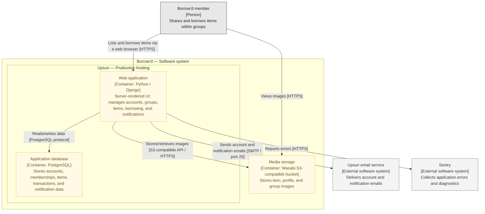

# Container diagram

This [C4 container diagram](https://c4model.com/diagrams/container) expands the
[system context diagram](SystemContextDiagram.md) to show Borrow'd's application
and data stores in production. The Upsun hosting boundary identifies where the
web application and database run; the media bucket is hosted separately by Wasabi.

The production configuration uses Upsun's built-in SMTP service via
`PLATFORM_SMTP_HOST` on port 25; see
[`borrowd/config/prod/django.py`](../../borrowd/config/prod/django.py). The hosting
configuration is defined in [`.platform.app.yaml`](../../.platform.app.yaml) and
[`.platform/services.yaml`](../../.platform/services.yaml).
