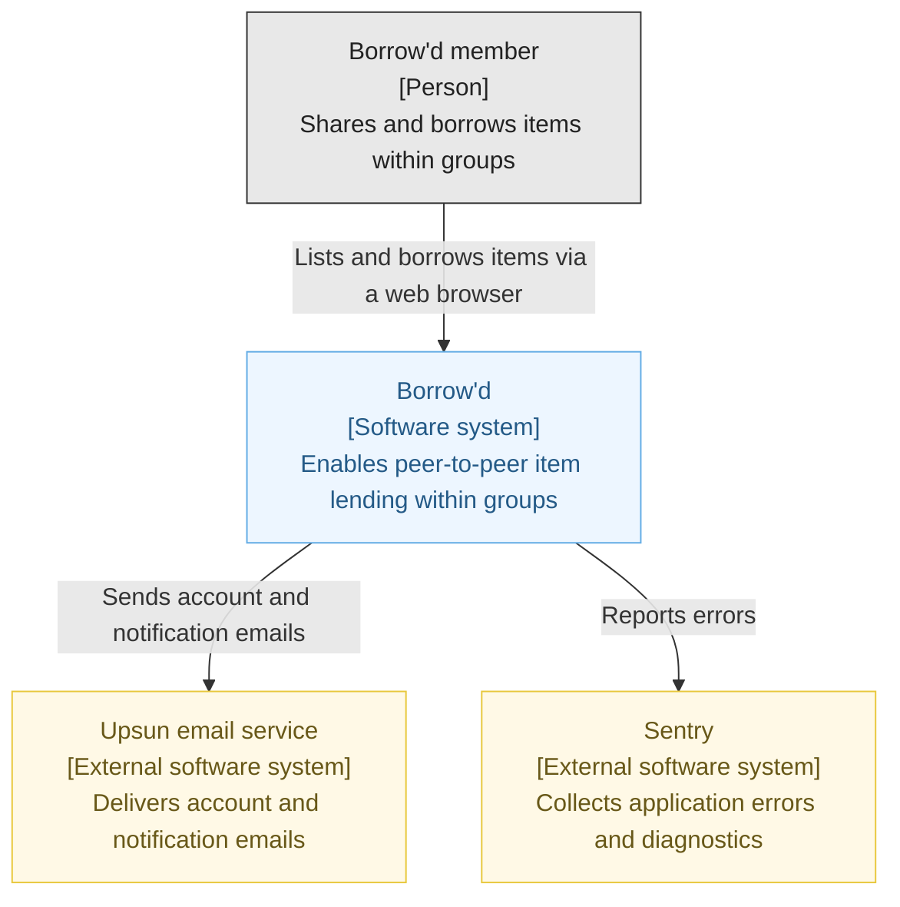

# System context diagram

This [C4 system context diagram](https://c4model.com/diagrams/system-context) shows
Borrow'd, its members, and the external services it uses in production. See the
[container diagram](ContainerDiagram.md) for the application's internal structure.

